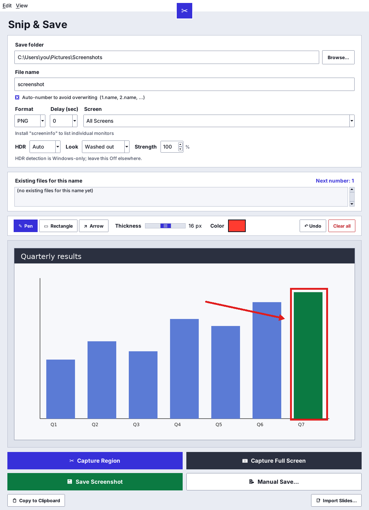

# Snip & Save

A screenshot tool for people who take a lot of screenshots and want them filed
properly. Capture a region or a full screen, mark it up with a pen, box or
arrow, and save it to a folder of your choice with automatic numbering
(`1.screenshot.png`, `2.screenshot.png`, …). Every capture is also copied to the
clipboard.

It's a single Python file with one required dependency (Pillow). It's built
mainly for Windows and also runs on macOS and Linux.



## Features

- **Region or full-screen capture**, with a 0, 3, 5 or 10 second delay. The
  region overlay is scale-corrected, so the selection lines up on HiDPI and
  scaled displays.
- **Multi-monitor aware.** Capture all screens, one monitor, or "Other
  Display", which works out which monitor the app is on and captures the
  other one(s).
- **Annotate in place** with a pen, rectangle or arrow in any thickness and
  colour. Shift snaps to squares and 45° arrows, and Ctrl+Z undoes. You can
  save, keep drawing and save again.
- **Organised saving.** Saves go to a remembered folder and base name, with
  auto-numbering that continues from any number you type. A side panel lists
  existing matches and shows the next number.
- **HDR correction on Windows.** The app reads each monitor's HDR state and
  SDR white level from the Windows display configuration, then tone-maps HDR
  captures back to SDR so they don't come out washed out. The correction is
  non-destructive, so toggling it re-renders without re-capturing.
- **Print Screen integration on Windows.** Optionally takes over the Print
  Screen key. Windows' own setting is switched off while the option is on and
  restored when it's off.
- **Quick-capture button**: a small always-on-top scissors button for
  one-click region captures. It hides itself during every capture.
- **Import slides.** Converts every slide of a .pptx, .ppt or .odp deck into
  numbered images, skipping hidden slides. You can page through the deck and
  annotate each slide. It uses PowerPoint if it's installed and falls back to
  LibreOffice if not.
- **Settings persist**, including window size and position, all options and
  the last folders used.

## Install and run

Requires Python 3 with Tkinter, which is included in the standard
Windows and macOS installers.

```bash
pip install -r requirements.txt
python snip_and_save.py
```

Only Pillow is required. The optional packages each enable one feature:

| Package | What it adds |
| --- | --- |
| `screeninfo` | Choosing a specific monitor, or "Other Display" |
| `mss` | Faster captures (grabs only the area needed) |
| `pywin32` (Windows) | Clipboard copy, and slide import through PowerPoint |
| `pymupdf` | Faster slide rendering when using LibreOffice |

On Linux, clipboard copy needs `xclip` or `wl-copy`. Some setups also need
`scrot` or `gnome-screenshot` for screen grabs. Slide import without PowerPoint
needs [LibreOffice](https://www.libreoffice.org/download/).

Settings are saved to `snipper_config.json` next to the script. If that folder
isn't writable, they go in your user app-data folder instead.

## How it was built

I built Snip & Save with AI coding agents over 16 versions. For each version I
specified the behaviour I wanted, tested it on my own machine, and fed back
what broke until it worked the way I use it.

Most of the work went into problems that only showed up in real use:

- **HDR captures came out washed out.** The app now queries the Windows
  DisplayConfig API through `ctypes` for each monitor's HDR state and SDR white
  level, and applies a PQ tone-mapping lookup table to the raw capture.
- **Captures felt slow.** Window hide/show animations are switched off. The
  app waits exactly one screen refresh (`DwmFlush`) instead of a fixed timer,
  and grabs only the needed area with `mss`. The status line reports
  click-to-overlay time, so changes can be measured.
- **Settings sometimes vanished.** `os.access()` reports folders as writable
  on Windows when they aren't, so the app now really tries a write. A
  PyInstaller one-file exe's `__file__` points to a temp folder that is wiped
  on every launch. Config writes are atomic, so a crash can't leave a
  half-written file.
- **The Print Screen key could be held by another program.** The hotkey runs
  on its own thread, since Tk never receives thread-level `WM_HOTKEY` messages.
  If the key is taken, it retries in the background and claims it as soon as
  it's free.
- **Slide import broke without PowerPoint.** The fallback chain is PowerPoint
  through COM, then LibreOffice found on PATH, in common install folders or in
  the Windows registry, then rendering through a PDF.

## License

[MIT](LICENSE)
